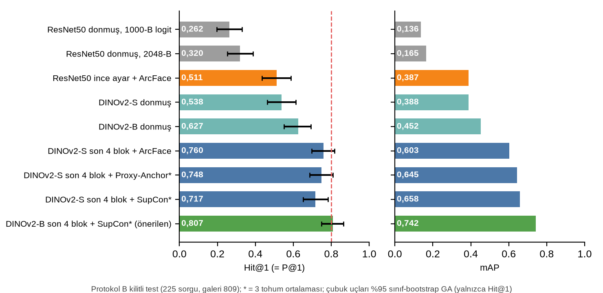
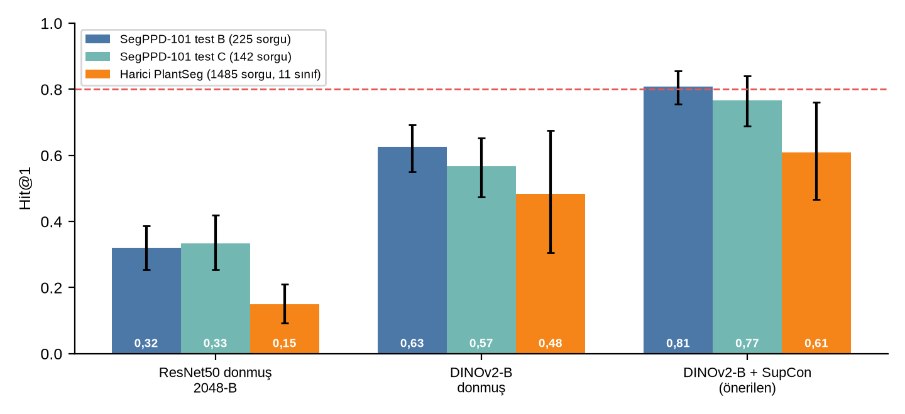
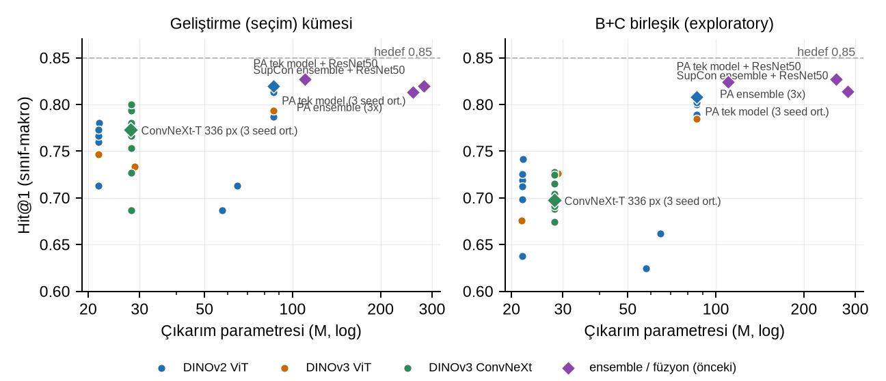

# SegPPD-CBIR

**Show it a sick leaf, get back the most similar labelled leaves. Measured honestly.**

SegPPD-CBIR is a content-based image retrieval (CBIR) study for plant diseases and pests on the
[SegPPD-101](https://doi.org/10.5281/zenodo.15114160) dataset. It starts from a training-free baseline
(frozen ResNet50 features + exact Euclidean ranking) and keeps the retrieval step unchanged. The only thing
that improves is the embedding space. The final model fine-tunes the last four blocks of **DINOv2-B** with a
**supervised contrastive loss (SupCon)** and lifts Hit@1 from **0.320 to 0.807** on a locked, leakage-free test
set. The evaluation includes a second locked set and an external test on PlantSeg images.

Every number in the report is checked against the saved artifacts by a script (`115/115 claims match`), and
every experiment that did *not* work is reported too.

```
   query image ──► DINOv2-B (ViT-B/14)  ──► CLS token ──► dropout + linear ──► 256-D embedding (L2)
   (+ h-flip)      blocks 1-8 frozen                                                │
                   blocks 9-12 + norm fine-tuned with SupCon (τ = 0.1)              │ exact Euclidean
                                                                                    ▼
   gallery images ─► same network, embedded offline ─────────────────────► ranked Top-K results
```

## Why

Telling which disease a leaf spot belongs to usually needs an expert. A system that returns the closest
*labelled* examples gives the expert, or the grower, something concrete to compare against. Field photos make
this hard: background, light, distance and framing vary, one disease looks different at different stages, and
different diseases can look almost the same.

Retrieval is not classification. The output is a ranking, so it is measured with ranking metrics
(Hit@K, Precision@K, mAP). The question here is simple: **how far can the embedding space be improved while the
retrieval step stays exactly the same?**

## Results

| Test set | Queries | Classes | Frozen ResNet50 (baseline) | Frozen DINOv2-B | **DINOv2-B + SupCon (proposed)** |
|---|---:|---:|---:|---:|---:|
| SegPPD-101, Protocol B (locked) | 225 | 75 | 0.320 | 0.627 | **0.807** [0.756, 0.856] |
| SegPPD-101, Protocol C (second locked set) | 142 | 75 | 0.333 | 0.567 | **0.767** [0.689, 0.840] |
| PlantSeg v2, external (leakage-screened) | 1,485 | 11 | 0.149 | 0.484 | **0.608** [0.466, 0.760] |

Hit@1, class-macro, mean of 3 seeds; brackets are 95% class-bootstrap confidence intervals. The proposed model
also reaches mAP 0.742 and ROC-AUC 0.989 on Protocol B. Training takes about 10-15 minutes on an RTX 4050
(6 GB, ~3 GB used); exact search over the 809-image gallery takes a median 0.26 ms per query.

<p align="center">
  
  
</p>

*Left: ablation steps on the locked Protocol B test (red line = 0.80 target). Right: the ranking of systems
stays the same on both locked sets and on the external set, while the absolute level drops on PlantSeg.*

### What did not help

- **Hand-crafted features** (HSV, Lab moments, LBP, HOG, GLCM, Gabor, edges): best mAP 0.050 against 0.154 for
  deep features; fusing them with deep features made results worse.
- **Feature maps as extra input** (concatenation or attention fusion): within noise or worse than RGB alone.
- **Oracle ROI cropping** with the ground-truth mask: +0.016 P@10, not significant.
- **Distance metrics** (cosine, inner product, L1, PCA whitening): no reliable gain over exact Euclidean.
- **Ensembles and ResNet50 fusion**: 0.822 and 0.840 Hit@1 on Protocol B, but the paired gain is not
  significant (fusion +0.018, 95% CI [-0.004, 0.044]); the best single cell (0.858) did not replicate on Protocol C.
- **Smaller backbones** (< 86 M parameters), depth pruning and knowledge distillation: accuracy drops
  consistently. A single DINOv2-B model matches the 282 M-parameter ensemble with 3.3× fewer parameters.

<p align="center">
  
</p>

## How the evaluation stays honest

- **Duplicate audit.** SHA-256 + perceptual hash (pHash ≤ 12, dHash ≤ 18) found 26 duplicate groups; 16 of them
  were the same photo under *different* labels. 43 images were removed, 2,220 remain.
- **Leakage-free splits.** Train, gallery, dev and test queries are disjoint at image and duplicate-group level.
- **Locked test sets.** Candidates and the headline definition were frozen before Protocol B was run, once.
  Protocol C is a second locked set. Model selection happened only on the dev set.
- **Cross-dataset leakage screen.** 867 PlantSeg images (7.6%) turned out to be copies or crops of SegPPD-101
  images (shared web sources) and were removed before the external test.
- **Reported, not hidden:** the 0.80 target is *not* statistically confirmed (the CI includes values below it;
  pooled B+C is 0.794 [0.741, 0.844]).

## Scope and limitations

- **75 of 101 classes.** 26 classes have only 7-12 usable images, too few for disjoint splits. The ~0.80 figure
  is a 75-class closed-set result, not a 101-class one.
- **Small test sets per class** (1-3 queries) mean wide confidence intervals.
- **Both locked sets are now consumed.** Any new model selection needs a fresh, untouched test set.
- **Relevance = same dataset label**, not a verified agronomic diagnosis. This is not a diagnostic tool.
- **External generalisation** drops to 0.61 and covers only 11 name-matched classes.

## Repository layout

```
src/segppd_cbir/     data audit, splits, feature extraction, training, evaluation, metrics
  cli.py             audit · split · extract · evaluate (training-free baseline)
  train_embed.py     DINOv2 / ResNet50 metric learning (ArcFace, Proxy-Anchor, SupCon)
  final_locked.py    one-shot evaluation of frozen candidates on the locked set
  external*.py       PlantSeg mapping, leakage screen, external evaluation
  rv2/ rv4/          loss study, distance metrics, re-ranking, parameter reduction
tests/               39 tests: parsing, duplicates, protocols, metrics, L2 ranking, embeddings
artifacts/           metrics (CSV/JSON), splits, audits, figures (no images, no weights)
report/              report builder, figure scripts, number verification
docs/                protocol, dataset audit, experiment logs, limitations
```

## Reproduce

Requirements: Linux, Python 3.12, [uv](https://docs.astral.sh/uv/). The default environment is CPU-only;
training uses a separate CUDA environment (`.venv-gpu`, see [`docs/RESUME.md`](docs/RESUME.md)).

```bash
git clone https://github.com/miclaldogan/segppd-cbir && cd segppd-cbir
uv sync
uv run pytest -q
```

The datasets are **not** in this repository. Download them from their own records and place them under `data/`:

| Dataset | Source | License | Expected path |
|---|---|---|---|
| SegPPD-101 | [Zenodo 10.5281/zenodo.15114160](https://doi.org/10.5281/zenodo.15114160) | MIT | `data/raw/SegPPD-101.rar` → `data/extracted/SegPPD-101/` |
| PlantSeg v2 (external test only) | [Zenodo 13958858](https://zenodo.org/records/13958858) | CC BY-NC-ND 4.0 | `data/external/plantseg/plantsegv2/` |

```bash
# training-free baseline: audit, splits, frozen ResNet50 features, exact-Euclidean evaluation
uv run python -m segppd_cbir.cli audit
uv run python -m segppd_cbir.cli split
uv run python -m segppd_cbir.cli extract
uv run python -m segppd_cbir.cli evaluate

# proposed model (GPU environment), one seed
.venv-gpu/bin/python -m segppd_cbir.train_embed --backbone dinov2s --variant base --mode partial \
    --lr_bb 3e-5 --loss supcon --seed 0 --tag D5_dinoB_p4_supcon_lr3e-5_s0

# report: tables, figures and the number check
uv run python report/build_data.py && uv run python report/make_figures.py
uv run python report/verify_numbers.py          # 115/115 claims match saved artifacts
```

`final_locked.py` only re-evaluates the frozen candidates; it must not be used to select models.

## Data rights

Dataset images, model weights and embeddings are not committed. The rights of the underlying SegPPD-101
photographs are undocumented, so the images must not be redistributed. For this reason the compiled report
(which shows example photographs) stays local, while the code that builds it is here. PlantSeg is
CC BY-NC-ND 4.0; only derived metrics and a URL-free split manifest are published.

## References

- Ge, Z. et al. *SegPPD-FS: Segmenting plant pests and diseases in the wild using few-shot learning.* Plant
  Phenomics, 2025. [doi:10.1016/j.plaphe.2025.100121](https://doi.org/10.1016/j.plaphe.2025.100121)
- Wei, T. et al. *PlantSeg: A Large-Scale In-the-wild Dataset for Plant Disease Segmentation.*
  [arXiv:2409.04038](https://arxiv.org/abs/2409.04038)
- Oquab, M. et al. *DINOv2: Learning robust visual features without supervision.* TMLR, 2024.
  [arXiv:2304.07193](https://arxiv.org/abs/2304.07193)
- Khosla, P. et al. *Supervised contrastive learning.* NeurIPS, 2020.
  [arXiv:2004.11362](https://arxiv.org/abs/2004.11362)

---

*Built by İclal Doğan as a university research project at Fırat University.*
